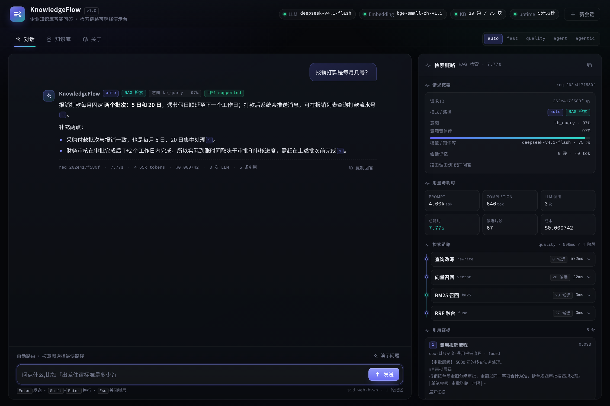
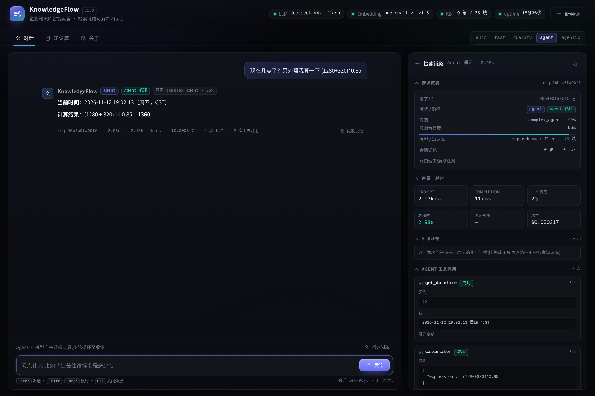
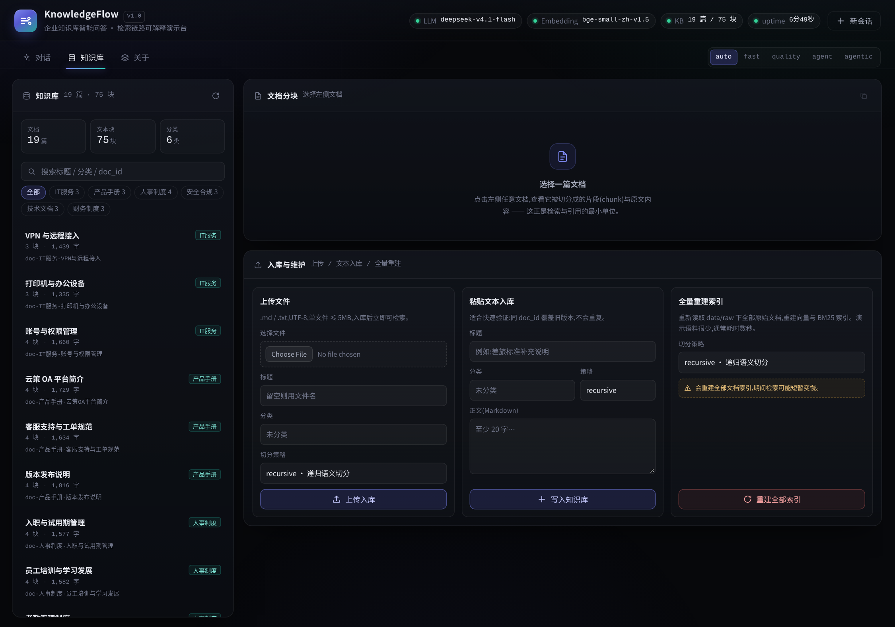
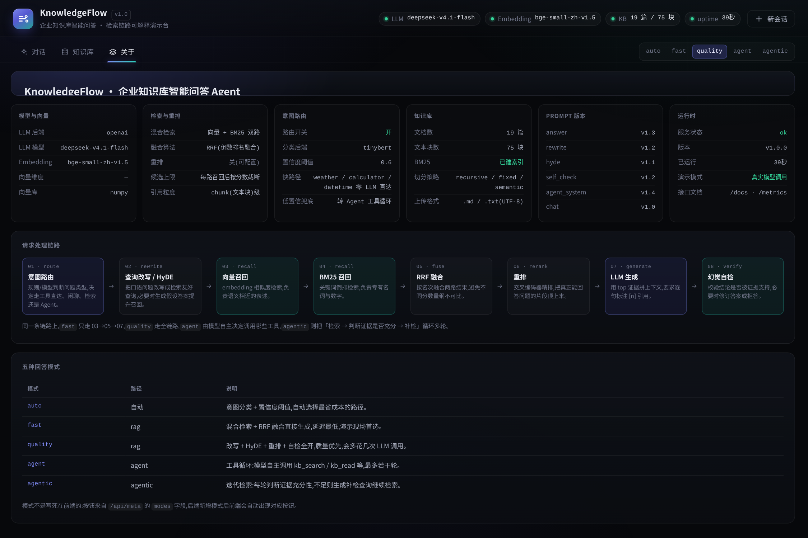
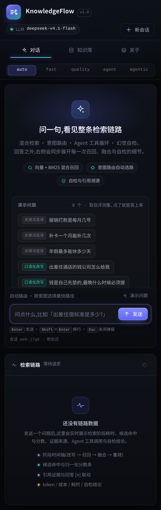
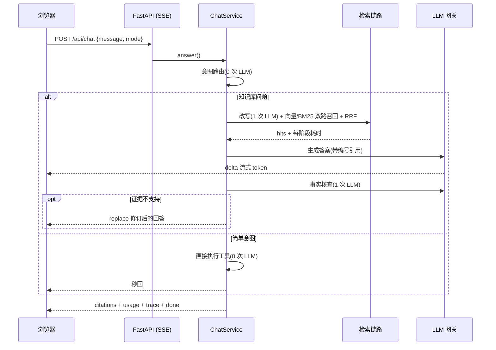

# KnowledgeFlow · 企业知识库智能问答 Agent

把散落的企业文档（制度、流程、产品手册、部署文档）变成**可溯源、可评测、可运营**的问答服务：
混合检索 + 意图路由 + Agent 工具循环 + Agentic 迭代检索 + 幻觉自检——一个 Java 后端工程师用 Python 从 0 到 1 独立实现的完整工程。

> 评测方法与全部数据见 [docs/EVALUATION.md](docs/EVALUATION.md)，架构与取舍见 [docs/ARCHITECTURE.md](docs/ARCHITECTURE.md) / [docs/DECISIONS.md](docs/DECISIONS.md)；
> 3 分钟讲稿、38 道深挖题、演示脚本、简历 bullet 见 [docs/INTERVIEW.md](docs/INTERVIEW.md)、[docs/DEMO.md](docs/DEMO.md)、[docs/RESUME.md](docs/RESUME.md)。

```
用户提问 ─► 意图路由 ─┬─ fast   → 确定性工具(天气/计算/时间)      0 次 LLM
                      ├─ chat   → 闲聊                              1 次 LLM
                      ├─ rag    → 混合检索 → 生成 → 自检            3 次 LLM
                      ├─ agent  → Function Calling 工具循环(≤3 轮)  1~4 次 LLM
                      └─ agentic→ 迭代检索直到证据充分              2~5 次 LLM
                                        │
                                        ▼
                        向量(bge) + BM25(jieba) → RRF 融合 → 重排(可选)
                                        │
                                        ▼
                        带 [编号] 引用的回答 + 检索链路可回放 + token/成本计量
```

## 界面

| 对话 + 检索链路（quality 模式） | Agent 工具循环 |
| --- | --- |
|  |  |

| 知识库管理 | 架构说明页 |
| --- | --- |
|  |  |

| 移动端 |
| --- |
|  |

> 全部是真实运行截图：回答带 `[n]` 引用，右侧是本次请求的检索链路（阶段耗时、候选、证据、自检结论、token/成本）；
> Agent 模式下能看到每次工具调用的入参、输出与耗时。

## 30 秒跑起来（不需要任何 API Key）

```bash
git clone <repo-url> && cd knowledgeflow-agent
./run.sh            # 首次会自动装依赖、建索引，然后打开 http://127.0.0.1:8000
```

无 Key 时自动进入**离线演示模式**：LLM 用确定性 Mock，检索、引用、链路可视化、Agent 工具调用**全部真实可跑**；
在 `.env` 里填上任意 OpenAI 兼容网关的 `LLM_API_KEY` 即自动切换真实模型，无需改代码。

也可以只跑 API：

```bash
make setup          # uv sync --python 3.12 --extra ml --group dev
make seed           # 文档 -> 分块 -> 向量 + BM25 索引
make run            # http://127.0.0.1:8000
make test           # 103 个离线测试(不联网、不花钱)
```

## 它解决什么问题

企业知识库问答的难点从来不是"接个大模型"，而是：

| 真实痛点 | 本项目的做法 | 效果 |
| --- | --- | --- |
| 口语化提问检索不到（"住酒店的钱怎么找公司要"） | 向量 + BM25 双路召回 + RRF 融合 + 查询改写 | 检索 Top-1 从 62.5%（纯 BM25）提升到 **90%** |
| 简单请求也走大模型，又慢又贵 | 意图路由：5 类意图，简单意图 0 次 LLM | 简单请求 P95 从 ~2.5s 降到 **20ms** |
| 多跳问题一次检索覆盖不全 | Agentic RAG：判断证据充分性，不足带反馈再查 | 多跳问题可自动检索 2~3 轮 |
| 模型编造制度、数字、流程 | 独立 judge + 证据的事实核查，无依据就拒答 | 库外问题拒答率见评测报告 |
| "看起来能跑"但无法证明好坏 | 40 条检索评测集 + 12 条拒答集 + 消融实验脚本 | 所有结论可一键复现 |

## 核心设计（面试可展开讲的部分）

1. **混合检索 + RRF**：向量（`bge-small-zh-v1.5`，512 维）与 BM25（jieba 搜索模式分词）各召回 20 条，用 Reciprocal Rank Fusion 按名次融合——不依赖两路分数的可比性。
2. **多级检索优化**：查询改写（指代消解）→ HyDE（假设文档召回）→ Cross-Encoder 重排，**逐级做消融**，有用才留、没用就默认关闭（见评测：HyDE 与本语料无增益）。
3. **意图路由**：微调 TinyBERT（自建 660 条 6 类数据，eval 132 条，准确率 **96.2%**、Macro-F1 0.962），CPU 单条约 50ms；模型缺失时自动降级为规则分类器（准确率 59.9%）。
4. **Agent 决策循环**：OpenAI Function Calling 协议、5 个工具（`kb_search`/`kb_read`/`calculator`/`get_datetime`/`get_weather`），≤3 轮硬上限 + 超限强制收敛 + 工具异常隔离。
5. **Agentic RAG**：检索由 Agent 主动驱动，judge 判断证据是否充分，不充分就带"缺什么"的反馈改写再查。
6. **幻觉自检**：把草稿与检索证据交给独立调用做事实核查，`supported / partial / unsupported` 三态，unsupported 直接拒答。
7. **混合记忆**：滑动窗口 + 超阈值摘要压缩（token 有上界）+ SQLite 长期偏好 + 话题漂移检测。
8. **工程化**：SSE 流式、请求级 trace（阶段耗时/候选/分数）、`/metrics`、103 个离线测试、GitHub Actions、Docker Compose、systemd/nginx 部署样例、prompt 版本化与热加载。

## 一次问答发生了什么



前端的「检索链路」面板会把这些阶段、候选片段、分数与耗时实时画出来——面试时可以边答边指。

## 评测结果（真实跑出来的，可复现）

评测集：19 篇原创企业文档 / 75 个块，40 条检索问题（keyword 14 / paraphrase 16 / multi_hop 6 / noisy 4）+ 12 条库外问题。

| 配置 | Top-1 | Top-3 | MRR | P50 延迟 |
| --- | --- | --- | --- | --- |
| BM25（关键词） | 62.5% | 85.0% | 0.749 | 0.5 ms |
| 向量（bge-small-zh） | 85.0% | 100% | 0.917 | 19 ms |
| 混合 + RRF | 85.0% | 92.5% | 0.893 | 17 ms |
| + 查询改写 | **90.0%** | 100% | **0.938** | 0.65 s |
| + HyDE | 92.5% | 100% | 0.958 | 3.6 s |
| + 重排（Cross-Encoder） | 90.0% | 100% | 0.950 | 3.1 s |

结论与取舍（详见 [docs/EVALUATION.md](docs/EVALUATION.md)）：语义检索补上了关键词检索对"口语化改写"的短板——paraphrase 类 Top-1 从 BM25 的 31% 提升到混合+改写后的 **81%**；HyDE 只带来 +2.5pt 却多花 3s，重排在当前语料上反而 -2.5pt，所以两者默认关闭、保留为开关（有数据支撑的"不用"）。

意图分类：TinyBERT 微调 95s，eval 132 条准确率 **96.2%**（规则基线 59.9%，同数据集）；单条推理约 50ms，远低于一次 LLM 调用。
端到端（真实模型）：quality 模式 40 条问题，**引用命中 @3 = 97.5%**、库外问题**拒答率 100%**，延迟 P50 10.4s / P95 14.5s，单次成本约 $0.0009；fast 模式 P50 4.6s、拒答率 83%——自检的收益和代价都能量化。

## 目录结构

```
app/
├── config.py           # 唯一配置入口(auto 降级:无 Key -> mock,无 ML -> hash 向量)
├── llm/                # 模型层:base 协议 / openai_compat / mock / factory(自动降级)
├── rag/                # 检索:分块(3 策略)/embedding/向量库(numpy|chroma)/BM25/RRF/重排/改写/编排
├── agent/              # Agent:5 工具 + 注册表(校验/超时/截断/隔离)+ Function Calling 循环
├── agentic/            # Agentic RAG:迭代检索 + 证据充分性判断
├── nlu/                # 意图:微调 TinyBERT + 规则兜底 + 槽位 + 路由
├── memory/             # 记忆:滑动窗口 / 摘要压缩 / SQLite 偏好 / 话题漂移
├── quality/            # 幻觉自检(独立 judge + 证据)
├── prompts/            # Jinja2 模板 + 版本号 + 热加载
├── obs/                # trace / metrics / 日志
├── services.py         # 编排层:意图 -> 检索/Agent -> 生成 -> 自检 -> 记忆 -> 事件流
├── api/                # FastAPI:SSE 对话 / 知识库管理 / meta / health / metrics
└── cli/                # 命令行:6 种模式交互
web/                    # 演示前端(原生 JS,无构建、无 CDN)
scripts/                # 入库 / 检索消融 / 端到端评测 / 基准 / 意图训练与评测
tests/                  # 103 个离线测试
deploy/                 # systemd / nginx 样例
docs/                   # 架构 / ADR / 评测 / 面试 / 演示脚本 / API 契约
data/                   # raw 语料(19 篇原创) + 检索/拒答/意图评测集
```

## 质量保障

- **103 个离线测试**：`pytest -q` 全绿，覆盖分块、RRF、BM25、向量库、工具安全（AST 白名单）、Agent 轮数上限、记忆压缩、意图路由、自检拒答、API/SSE。
- **CI**：ruff + mypy + pytest + Docker 构建（`.github/workflows/ci.yml`）。
- **可观测**：每个请求有 `request_id`、阶段耗时、token、成本；`GET /metrics` 输出 Prometheus 文本。
- **可复现**：所有评测脚本固定随机性、离线可跑；`eval/report-*.json` 为原始数据。

## 已知限制

- 评测集与语料是自建的（19 篇虚构公司文档），规模不足以代表真实企业语料分布，结论需在生产语料上复核。
- Agentic RAG 的多跳判断依赖 LLM 质量；网关抖动时会降级为单轮检索。
- 语义缓存、多租户隔离、文档异步解析（大 PDF）尚未实现，列为 roadmap。

## License

MIT
