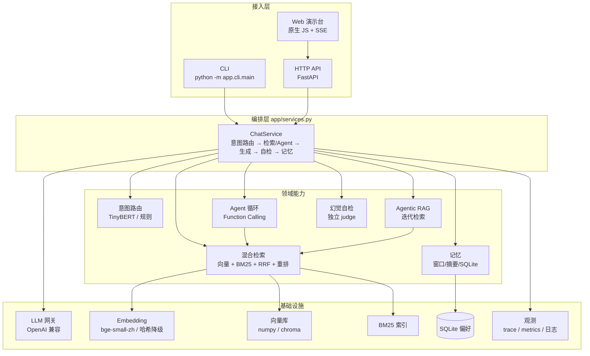

# 架构设计

> 目标读者：面试官 / 想接手这个项目的人。看完应该能回答"这个系统由哪些部分组成、一次请求怎么流动、为什么这么拆"。

## 1. 分层总览



**为什么把编排单独抽一层？**
API、CLI、评测脚本三处的"一次问答"逻辑必须完全一致，否则评测测的不是线上路径。
`ChatService.answer()` 产出的是一条事件流（meta/retrieval/delta/citations/usage/done），
API 把它编码成 SSE、CLI 把它渲染成终端输出、评测脚本把它收敛成 JSON——同一份逻辑三种消费方式。

## 2. 两条核心链路

### 2.1 入库（离线，幂等）

```
data/raw/*.md
   → 解析（剥 front matter / HTML 转文本）
   → 分块（recursive 默认；fixed / semantic 可切换）
   → 元数据（doc_id / 标题 / 分类 / 块序号 / 所属小节）
   → embedding（bge-small-zh 512 维，或哈希降级）
   → 向量库（numpy 精确余弦 / chroma）
   → 重建 BM25（jieba 搜索模式分词）
   → 原子写入 data/index（npy + json + pkl）
```

要点：
- **块级元数据带 `doc_id` 与块序号**：检索命中块 → 能回溯到整篇文档（`kb_read` 工具展开全文）、前端能展示来源。
- **BM25 与向量库同源**：都从同一批 chunk 构建，保证混合检索的两路结果可以按 `chunk_id` 融合。
- **原子写入 + 维度校验**：进程被杀不会留半个索引；换了 embedding 模型（维度变化）启动时自动重建，不会静默返回错误结果。

### 2.2 问答（在线，流式）

```
POST /api/chat {message, mode}
  → 记忆维护（超阈值压缩 + 话题检测）
  → 意图路由（confidence < 阈值 → agent 兜底）
  → 按路径执行：
      fast    : 槽位抽取 → 工具执行（0 次 LLM）
      chat    : LLM 闲聊（1 次）
      rag     : 检索（fast 2 路 / quality 改写+HyDE+重排）→ 生成（流式）→ 自检
      agent   : Function Calling 循环（工具结果回填）
      agentic : 迭代检索直到 judge 判定证据充分
  → 记忆写回 + 每 3 轮抽取长期偏好
  → 事件流：meta / retrieval / delta* / citations / self_check / usage / done
```

## 3. 检索子系统

| 组件 | 实现 | 关键取舍 |
| --- | --- | --- |
| 分块 | 固定窗口 / 递归（标题→段落→句子）/ 语义（句向量相似度断点） | 默认递归：块边界落在语义边界，块内保留小节标题前缀 |
| 向量化 | `bge-small-zh-v1.5`（512d，CPU ~10ms/条）；query 侧加 bge 官方检索指令前缀 | 不在进程内加载大模型；无 ML 依赖时降级为特征哈希 |
| 向量库 | 默认 numpy 精确余弦；可选 ChromaDB | 7.5 万块以内精确检索 < 15ms，ANN 在这个规模没有收益，见 ADR-02 |
| 关键词 | BM25Okapi + jieba 搜索模式分词；小语料 IDF 可能为负，此时仍按分数返回 Top-K | 中文必须分词，否则"费用报销"是生词 |
| 融合 | RRF：`Σ 1/(k+rank)`，k=60，支持通道权重 | 只用名次，规避两路分数量纲不同的问题 |
| 改写 | LLM 指代消解 + 去口语化，输出单行查询，失败回退原查询 | 与 HyDE 并发执行，省一轮 RTT |
| HyDE | 生成假设答案文档再向量化 | 默认关闭：本语料无增益（见评测） |
| 重排 | Cross-Encoder（bge-reranker-base），只对融合后 Top-N 打分，sigmoid 转 0~1 | 默认关闭，按需开启；模型缺失自动跳过 |

每次检索返回 `RetrievalTrace`：每个阶段的耗时、候选数量、命中片段与分数。
它既是前端「检索链路」数据源，也是消融评测的原始数据——**一套埋点，两种用途**。

## 4. Agent 子系统

- **工具协议**：OpenAI Function Calling（JSON Schema 描述参数），5 个工具。
  - `kb_search` → 返回带 `[编号] + 标题 + doc_id` 的片段；
  - `kb_read` → 用 `doc_id` 展开整篇文档（Search/Read 分工，模仿人类查文档）；
  - `calculator`（AST 白名单求值，禁用 `**`/函数调用）、`get_datetime`、`get_weather`（外部 API 的代表）。
- **循环**：assistant 消息原样带 `tool_calls` 回填 → 逐个执行 → `role=tool` 消息按 `tool_call_id` 对应 → 直到不再请求工具。
- **防呆**：
  - 轮数上限 3；到上限时禁用工具、强制模型收敛；
  - 工具执行有超时（线程池 + `future.result(timeout)`）与输出截断；
  - 参数校验（required/type/enum）在注册表层完成；
  - 任何异常转成 `is_error=True` 的文本，交给模型自我修正，绝不冒泡打断请求。

## 5. 可靠性与降级矩阵

| 故障场景 | 系统行为 |
| --- | --- |
| 没有 LLM_API_KEY | 自动切 MockLLM（确定性离线演示），页面标注"离线演示模式" |
| 网关 4xx/5xx、超时、流中断 | 指数退避重试（含 403 upstream_refused）→ 仍失败则降级 Mock |
| 未安装 torch / sentence-transformers | embedding 降级为特征哈希，检索仍可用（词面相似） |
| 向量库维度与当前模型不一致 | 启动时检测并自动重建索引 |
| 重排模型加载失败 | 跳过重排，返回融合结果 |
| 知识库为空 | 返回明确提示与入库指引，不编造 |
| 检索无命中 | 固定话术 + 建议，不硬答 |
| 自检判 unsupported | 拒答话术（宁可少答，不可错答） |
| 单实例重启 | 索引从磁盘加载，SQLite 偏好保留，会话内记忆丢失（有损，可接受） |

## 6. 部署拓扑

```
                  ┌──────────────┐
  浏览器 / LAN ──► │ nginx (可选) │──► uvicorn :8000 (1 worker)
                  └──────────────┘        │
                                          ├── data/index (npy/json/pkl，只读加载)
                                          ├── data/memory (SQLite 偏好)
                                          └── 外部 LLM 网关(OpenAI 兼容)
```

- 单进程单 worker：模型与索引常驻内存（~600MB），多 worker 会重复加载；横向扩展时把 embedding 拆成独立推理服务（架构上已留接口）。
- 生产建议：embedding/rerank 走独立服务 + 向量库换 Qdrant/Milvus、索引异步构建、多副本前加统一网关。

## 7. 可观测性

- `RequestTrace`：request_id、模式、路径、各阶段耗时、LLM 调用次数与用途分布、token、自检结论。
- `GET /metrics`：请求数、错误数、延迟 P50/P95、token/成本累计、知识库规模（Prometheus 文本）。
- 日志：统一格式，三方库降噪；关键节点（入库、降级、自检拒答）都有日志。

## 8. 代码入口索引

| 想知道… | 看这里 |
| --- | --- |
| 一次问答怎么编排 | `app/services.py` |
| 检索怎么融合 | `app/rag/pipeline.py` + `app/rag/hybrid.py` |
| 工具怎么注册与防护 | `app/agent/registry.py` |
| 意图路由怎么决策 | `app/nlu/router.py` |
| 离线模式怎么实现 | `app/llm/mock.py` + `app/config.py#resolved_*` |
| 前端怎么拿链路数据 | `app/rag/schemas.py#RetrievalTrace` + `docs/API.md` |
